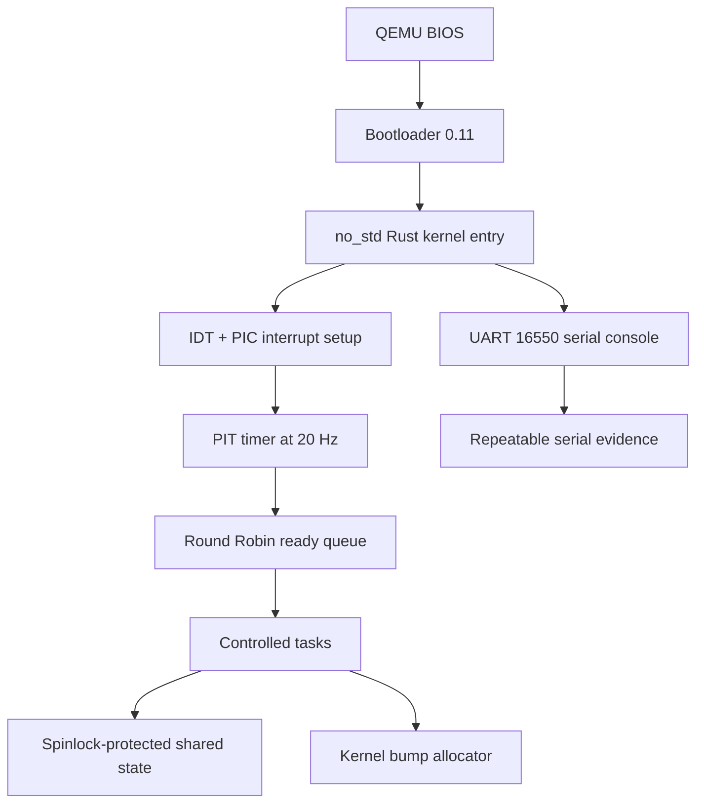

# Micro-OS

## A small Rust kernel that makes operating-system mechanisms visible

Micro-OS is an educational x86_64 operating system built for the CA-6 Rust Micro-OS engineering project. It boots through a BIOS bootloader in QEMU, writes a serial trace, configures a hardware timer interrupt, schedules controlled tasks with Round Robin, protects shared state with a spinlock, and allocates memory from a kernel bump allocator.

> **Build the mechanism. Boot the kernel. Read the evidence.**


## What It Demonstrates

| Mechanism | Implementation | Evidence |
| --- | --- | --- |
| Boot | Rust `no_std` kernel loaded by a BIOS bootloader | `[BOOT]` serial output |
| Console | UART 16550 serial writer | QEMU terminal trace |
| Tasks | Fixed task representation and lifecycle states | Task creation and termination logs |
| Scheduling | FIFO ready queue with Round Robin selection | Per-tick scheduler trace |
| Timer | PIT configured at 20 Hz | Hardware timer interrupts |
| Interrupts | IDT handler and remapped PIC | Kernel initialization trace |
| Synchronization | Spinlock-protected shared counter and queue | Correct counter updates |
| Memory | 64 KiB monotonic bump allocator | Allocation result in trace |
| Validation | Rust integration tests and trace analysis | `cargo test` and Python metrics |

## Boot Output

This is the actual QEMU output produced by the kernel, not a simulated application banner:

```text
Micro-OS Rust kernel booted
[BOOT] x86_64 bootloader transferred control to kernel
[INIT] serial console initialized
[INIT] IDT, PIC and PIT timer initialized
[TASK] created shell, logger and worker
[MEM] allocated 128 bytes from kernel bump heap
[RUN] timer-driven Round Robin scheduling started
[SCHED] tick=2 task=1 (shell)
[SCHED] tick=3 task=2 (logger)
[SCHED] tick=4 task=3 (worker)
[SCHED] tick=6 task=2 (logger) TERMINATED
[SCHED] tick=10 task=3 (worker) TERMINATED
[DONE] switches=9 completed_tasks=3
```

## Architecture



The repository has two layers:

- `kernel/` contains the real bare-metal `no_std` kernel.
- The root crate contains host-side mechanism tests, the image builder, documentation, and analysis tooling.

## Project Layout

```text
micro-os/
├── kernel/
│   ├── Cargo.toml
│   └── src/main.rs          # real no_std kernel
├── src/
│   ├── kernel.rs            # host integration model
│   ├── memory.rs            # host allocator model
│   ├── scheduler.rs         # host Round Robin model
│   ├── sync.rs              # host spinlock
│   ├── task.rs              # host task model
│   └── timer.rs             # host timer model
├── tests/kernel_mechanisms.rs
├── build.rs                 # kernel artifact -> BIOS image
├── scripts/run_qemu.ps1    # boot helper
├── scripts/analyze_trace.py
├── docs/architecture.md
├── docs/testing.md
└── docs/report-template.md
```

## Requirements

- Windows, Linux, or macOS
- Rust nightly
- `x86_64-unknown-none` target
- `llvm-tools-preview` and `rust-src`
- QEMU
- Windows users: Visual Studio Build Tools with **Desktop development with C++**

The repository includes [`rust-toolchain.toml`](rust-toolchain.toml), which selects nightly and the bare-metal target automatically. On a fresh machine, install the remaining components with:

```powershell
rustup component add llvm-tools-preview rust-src
rustup target add x86_64-unknown-none
```

## Run It

Open a Visual Studio Developer Command Prompt on Windows, then:

```powershell
cd "C:\Users\Vedesh\Desktop\JGI\Sem-3\OS\micro-os"
cargo test
cargo build
.\scripts\run_qemu.ps1
```

The build creates `target/micro-os-bios.img`. The QEMU helper connects the kernel UART to the terminal and exits automatically after the integrated run completes.

On Linux or macOS, use the same Cargo commands and ensure `qemu-system-x86_64` is on `PATH`.

## Capture Evidence

```powershell
.\scripts\run_qemu.ps1 | Tee-Object traces\qemu-boot.log
python scripts\analyze_trace.py traces\qemu-boot.log
```

The analyzer reports timer ticks, scheduler switches, task turns, and the fairness range. The captured trace is suitable for the CA-6 report and demonstration.

## Tests

The automated suite covers:

- Round Robin fairness and task completion
- Task state transitions
- Timer quantum boundaries
- Aligned allocations and allocation failure
- Spinlock-protected mutation

Run all tests with:

```powershell
cargo test
```

## Design Boundary

Micro-OS is intentionally small. Its tasks are controlled kernel workloads, not isolated user processes with separate address spaces and saved CPU register contexts. This keeps the core mechanisms visible, deterministic, and explainable in a viva.

The natural next extensions are:

1. Separate task stacks and saved register contexts
2. User/kernel privilege separation
3. A priority or MLFQ scheduler specialization
4. Page-frame allocation and paging
5. A minimal system-call interface

## Documentation

- [Architecture](docs/architecture.md)
- [Testing and evidence](docs/testing.md)
- [Report template](docs/report-template.md)

## Academic Context

This repository implements the core of **CA-6: Rust Micro-OS Engineering Project**:

> Design and implement a minimal educational Micro-OS in Rust, integrating task management, scheduling, timer-driven execution, synchronization, and memory management, then validate the mechanisms with controlled evidence.

AI assistance was used for scaffolding, debugging hypotheses, and documentation. The implementation was compiled, tested, booted in QEMU, and reviewed against the assignment requirements.

## License

This project is intended for educational use and coursework demonstration.
# micro-os
