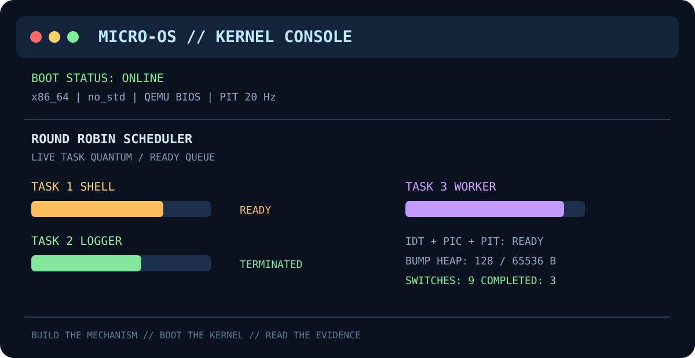
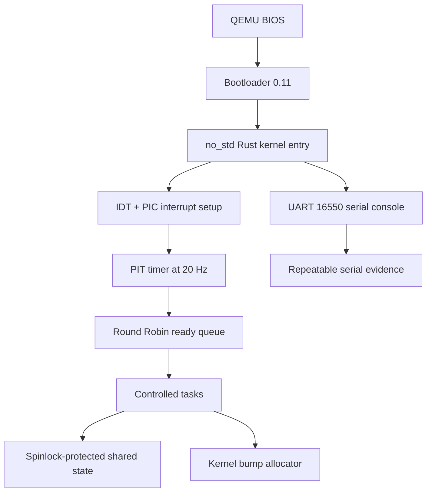

# Micro-OS

## A small Rust kernel that makes operating-system mechanisms visible

Micro-OS is an educational x86_64 operating system built for the CA-6 Rust Micro-OS engineering project. It boots through a BIOS bootloader in QEMU, writes a serial trace, configures a hardware timer interrupt, schedules controlled tasks with Round Robin, protects shared state with a spinlock, and allocates memory from a kernel bump allocator.

> **Build the mechanism. Boot the kernel. Read the evidence.**




## Navigate

[Overview](#what-it-demonstrates) | [Run it](#run-it) | [Architecture](#architecture) | [Tests](#tests) | [Evidence](#capture-evidence) | [CA-6 map](#ca-6-requirement-map) | [Troubleshooting](#troubleshooting)

## At A Glance

| | Result |
| --- | --- |
| Kernel | Rust `no_std` x86_64 kernel |
| Boot path | BIOS bootloader -> QEMU -> kernel entry |
| Scheduler | Timer-driven Round Robin |
| Timer | PIT at 20 Hz, remapped PIC, IDT handler |
| Memory | 64 KiB monotonic bump heap |
| Synchronization | Spinlock-protected shared kernel state |
| Evidence | UART trace, framebuffer dashboard, Python metrics |
| Latest run | 9 switches, 3 completed tasks, 5 tests passing |

## What It Demonstrates

| Mechanism | Implementation | Evidence |
| --- | --- | --- |
| Boot | Rust `no_std` kernel loaded by a BIOS bootloader | `[BOOT]` serial output |
| Console | UART 16550 serial writer | QEMU terminal trace |
| Tasks | Fixed task representation and lifecycle states | Task creation and termination logs |
| Scheduling | FIFO ready queue with Round Robin selection | Per-tick scheduler trace |
| Timer | PIT configured at 20 Hz | Hardware timer interrupts |
| Interrupts | IDT handler and remapped PIC | Kernel initialization trace |
| Synchronization | Spinlock-protected shared counter and queue | Correct counter updates |
| Memory | 64 KiB monotonic bump allocator | Allocation result in trace |
| Validation | Rust integration tests and trace analysis | `cargo test` and Python metrics |

## Boot Output

This is the actual QEMU output produced by the kernel, not a simulated application banner:

```text
Micro-OS Rust kernel booted
[BOOT] x86_64 bootloader transferred control to kernel
[INIT] serial console initialized
[INIT] IDT, PIC and PIT timer initialized
[TASK] created shell, logger and worker
[MEM] allocated 128 bytes from kernel bump heap
[RUN] timer-driven Round Robin scheduling started
[SCHED] tick=2 task=1 (shell)
[SCHED] tick=3 task=2 (logger)
[SCHED] tick=4 task=3 (worker)
[SCHED] tick=6 task=2 (logger) TERMINATED
[SCHED] tick=10 task=3 (worker) TERMINATED
[DONE] switches=9 completed_tasks=3
```

## Architecture



The repository has two layers:

- `kernel/` contains the real bare-metal `no_std` kernel.
- The root crate contains host-side mechanism tests, the image builder, documentation, and analysis tooling.

## What Happens During Boot

```text
1. QEMU starts target/micro-os-bios.img
2. Bootloader loads the kernel ELF and creates BootInfo
3. Rust entry point receives BootInfo
4. UART serial console and framebuffer dashboard initialize
5. IDT is loaded and the 8259 PIC is remapped
6. PIT is programmed for 20 Hz timer interrupts
7. Three controlled tasks enter the ready queue
8. A 128-byte aligned allocation is requested from the bump heap
9. Each timer tick selects the next ready task
10. Completed tasks leave the queue and QEMU exits cleanly
```

The serial console is the machine-readable evidence channel. The framebuffer is the human-readable visual channel. Both are driven by the same kernel state.

## Project Layout

```text
micro-os/
├── kernel/
│   ├── Cargo.toml
│   └── src/main.rs             # real no_std kernel
├── src/
│   ├── kernel.rs               # host integration model
│   ├── memory.rs               # host allocator model
│   ├── scheduler.rs            # host Round Robin model
│   ├── sync.rs                 # host spinlock
│   ├── task.rs                 # host task model
│   └── timer.rs                # host timer model
├── tests/kernel_mechanisms.rs
├── build.rs                    # kernel artifact -> BIOS image
├── scripts/run_qemu.ps1       # headless boot helper
├── scripts/run_qemu_window.ps1 # graphical QEMU window
├── scripts/analyze_trace.py
├── traces/qemu-boot.log
├── docs/assets/micro-os-dashboard.svg
├── docs/architecture.md
├── docs/testing.md
└── docs/report-template.md
```

## Requirements

- Windows, Linux, or macOS
- Rust nightly
- `x86_64-unknown-none` target
- `llvm-tools-preview` and `rust-src`
- QEMU
- Windows users: Visual Studio Build Tools with **Desktop development with C++**

The repository includes [`rust-toolchain.toml`](rust-toolchain.toml), which selects nightly and the bare-metal target automatically. On a fresh machine, install the remaining components with:

```powershell
rustup component add llvm-tools-preview rust-src
rustup target add x86_64-unknown-none
```

## Run It

Open a Visual Studio Developer Command Prompt on Windows, then:

```powershell
cd "C:/Users/Vedesh/Desktop/JGI/Sem-3/OS/micro-os"
cargo test
cargo build
./scripts/run_qemu.ps1
```

The build creates `target/micro-os-bios.img`. The headless QEMU helper connects the kernel UART to the terminal and exits automatically after the integrated run completes.

To see the kernel dashboard in an actual QEMU window:

```powershell
./scripts/run_qemu_window.ps1
```

The window shows the Micro-OS title, boot status, timer/PIC/PIT status, memory status, and three live task progress bars. Close the QEMU window after the final task reaches completion.

On Linux or macOS, use the same Cargo commands and ensure `qemu-system-x86_64` is on `PATH`.

## Command Reference

| Command | Purpose |
| --- | --- |
| `cargo test` | Run the host mechanism test suite |
| `cargo build` | Compile the kernel and create `target/micro-os-bios.img` |
| `./scripts/run_qemu.ps1` | Boot headlessly and print the serial trace |
| `./scripts/run_qemu_window.ps1` | Open the graphical framebuffer dashboard |
| `python scripts/analyze_trace.py traces/qemu-boot.log` | Calculate scheduler metrics |
| `cargo fmt --all` | Format all Rust crates |
| `git status` | Check local changes before submission |

## Capture Evidence

```powershell
./scripts/run_qemu.ps1 | Tee-Object traces/qemu-boot.log
python scripts/analyze_trace.py traces/qemu-boot.log
```

The analyzer reports timer ticks, scheduler switches, task turns, and the fairness range. The captured trace is suitable for the CA-6 report and demonstration.

Example analysis:

```text
timer_ticks: 10
scheduler_switches: 9
task_turns: {'1': 3, '2': 2, '3': 4}
fairness_range: 2
```

## Tests

The automated suite covers:

- Round Robin fairness and task completion
- Task state transitions
- Timer quantum boundaries
- Aligned allocations and allocation failure
- Spinlock-protected mutation

Run all tests with:

```powershell
cargo test
```

## CA-6 Requirement Map

| Assignment requirement | Where it is implemented | How to demonstrate it |
| --- | --- | --- |
| Rust kernel boot | `kernel/src/main.rs`, `bootloader_api` | Boot QEMU and show `[BOOT]` |
| Kernel console | UART 16550 writer and framebuffer screen | Terminal trace and QEMU window |
| Task representation | `Task`, `TaskState`, fixed task table | `[TASK]` and `[SCHED]` logs |
| Ready queue | `ReadyQueue` ring buffer | Observe queue rotation in source and trace |
| Round Robin | `run_one_step` requeues unfinished tasks | Task order 1, 2, 3, 1, 2, ... |
| Timer scheduling | PIT, IDT handler, PIC acknowledgement | Timer ticks trigger `[SCHED]` |
| Synchronization | `spin::Mutex` around queue/counter/screen | Shared counter remains consistent |
| Memory allocation | `BumpAllocator` implementing `GlobalAlloc` | `[MEM] allocated 128 bytes` |
| Diagnostics | Serial and framebuffer output | Save `traces/qemu-boot.log` |
| Validation | Rust tests and Python analyzer | `cargo test` plus metrics |

## Evidence Checklist

Before submission, collect:

- [ ] A screenshot of the graphical QEMU dashboard
- [ ] `traces/qemu-boot.log` from a fresh run
- [ ] Passing `cargo test` output
- [ ] Scheduler order and task completion evidence
- [ ] Timer/PIC/IDT initialization evidence
- [ ] Successful allocation evidence
- [ ] Python trace-analysis output
- [ ] Architecture diagram from `docs/architecture.md`
- [ ] Individual contribution statement
- [ ] AI usage disclosure in the final report

## How The Scheduler Works

The kernel uses a bounded ring queue. Each timer interrupt:

1. Locks the shared scheduler state.
2. Removes the task at the queue head.
3. Runs exactly one controlled work step.
4. Marks the task `Terminated` if no work remains.
5. Otherwise puts it at the queue tail.
6. Releases the lock and acknowledges the PIC interrupt.

This gives a clear, repeatable Round Robin trace without pretending that the current milestone already has full user-process context switching.

## Unsafe Code Boundary

The kernel uses `unsafe` only where hardware requires it:

- UART port initialization
- PIT port I/O
- PIC initialization and interrupt acknowledgement
- Raw framebuffer pixel writes
- The fixed kernel heap backing storage

Each area is isolated behind a small abstraction or operation. The host-side models remain safe Rust and are covered by tests.

## Design Boundary And Roadmap

Micro-OS is intentionally small. Its tasks are controlled kernel workloads, not isolated user processes with separate address spaces and saved CPU register contexts. This keeps the core mechanisms visible, deterministic, and explainable in a viva.

The natural next extensions are:

1. Separate task stacks and saved register contexts
2. User/kernel privilege separation
3. A priority or MLFQ scheduler specialization
4. Page-frame allocation and paging
5. A minimal system-call interface

## Troubleshooting

### `link.exe` not found

Open a **Developer Command Prompt for Visual Studio** or install the **Desktop development with C++** workload in Visual Studio Build Tools. The normal VS Code terminal does not automatically load MSVC paths.

### `qemu-system-x86_64` not found

Install QEMU or use the default Windows path expected by the helper:

```text
C:\Program Files\qemu\qemu-system-x86_64.exe
```

### `x86_64-unknown-none` target missing

Run:

```powershell
rustup target add x86_64-unknown-none
rustup component add llvm-tools-preview rust-src
```

### The QEMU window is blank

Rebuild the image with `cargo build`, then use `./scripts/run_qemu_window.ps1`. The current kernel renders its dashboard through the bootloader-provided framebuffer; the headless script intentionally hides the window and shows only serial output.

### QEMU remains open after the run

The visual launcher is intended for inspection and does not attach the debug-exit device. Close the QEMU window after the final task reaches completion, or use `./scripts/run_qemu.ps1` for an automatic exit.

## Safety Notes

Run this project in QEMU or another isolated emulator. Do not write the generated image to a physical disk or boot it on shared laboratory hardware without faculty approval.

## Documentation

- [Architecture](docs/architecture.md)
- [Testing and evidence](docs/testing.md)
- [Report template](docs/report-template.md)

## Academic Context

This repository implements the core of **CA-6: Rust Micro-OS Engineering Project**:

> Design and implement a minimal educational Micro-OS in Rust, integrating task management, scheduling, timer-driven execution, synchronization, and memory management, then validate the mechanisms with controlled evidence.

AI assistance was used for scaffolding, debugging hypotheses, and documentation. The implementation was compiled, tested, booted in QEMU, and reviewed against the assignment requirements.

## License

This project is intended for educational use and coursework demonstration.
